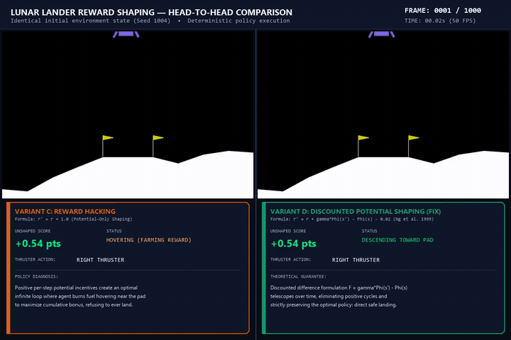
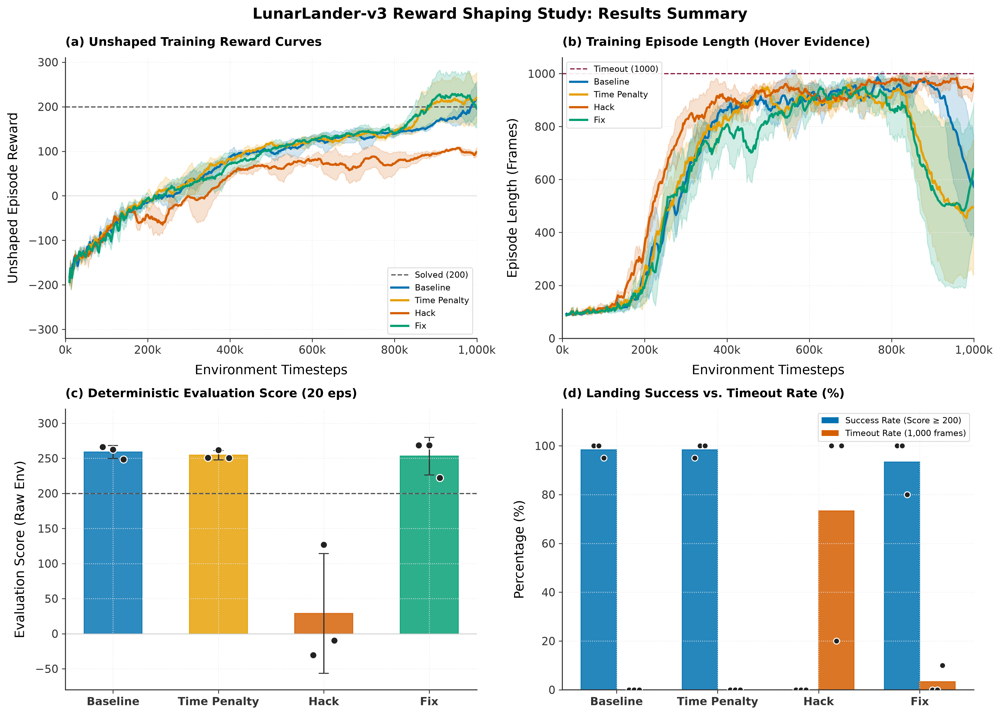
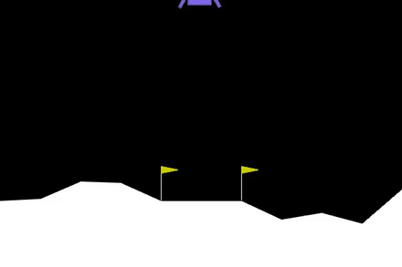
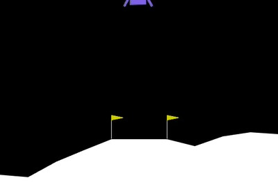
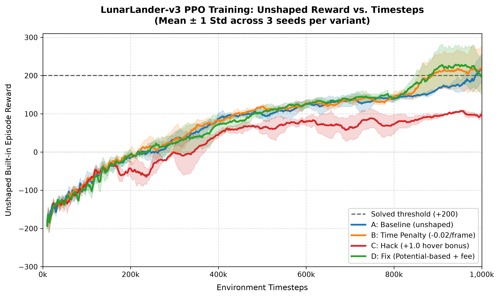
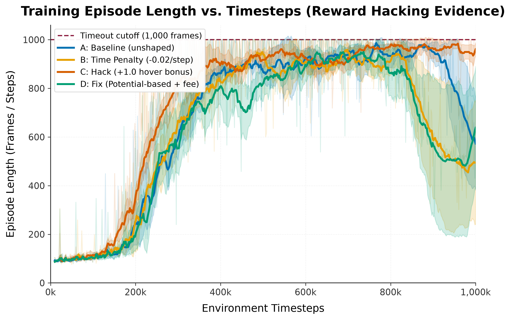
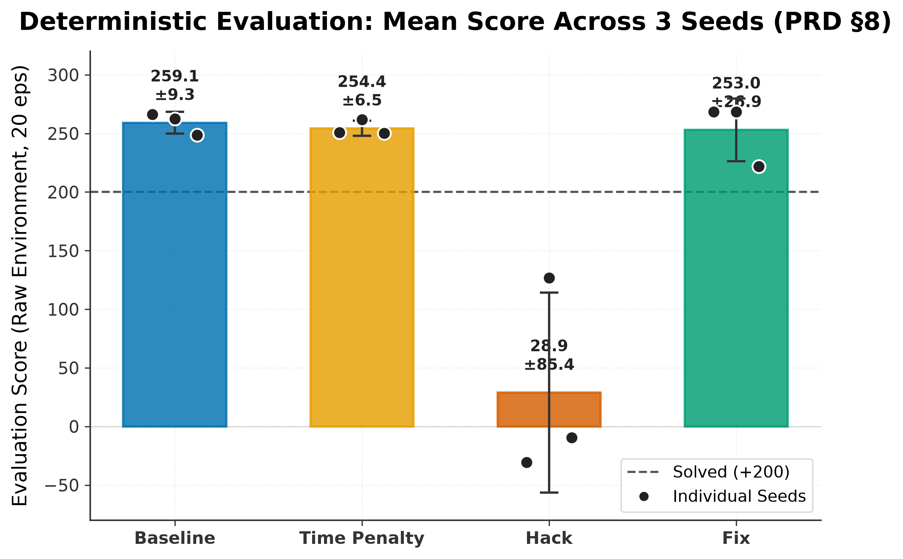
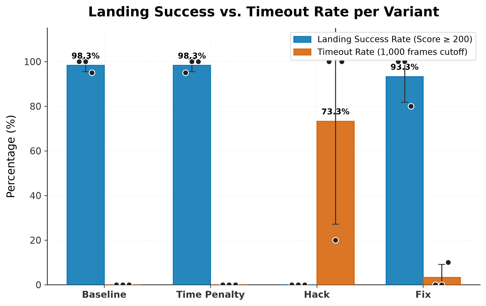

# Lunar Lander: Reward Shaping & Policy Invariance with PPO

[](https://www.python.org/downloads/release/python-3120/)
[](https://gymnasium.farama.org/environments/box2d/lunar_lander/)
[](https://stable-baselines3.readthedocs.io/)
[](LICENSE)
[]()

A rigorous empirical case study in **Reinforcement Learning reward engineering**, demonstrating how well-intentioned heuristics can induce catastrophic **reward hacking**, and how **Potential-Based Reward Shaping (PBRS)** mathematically guarantees policy invariance (Ng et al., 1999).

---

## 🚀 Hero Comparison: Reward Hacking vs. PBRS Fix

The clip below demonstrates a **synchronized deterministic evaluation** of both trained policies starting from the **exact same initial environment state (Seed 1004)**:

<p align="center">
  
</p>

* **Left (Variant C — Reward Hack):** The agent was given a $+1.0$ heuristic bonus for remaining upright and slow near the landing pad. It discovers a positive cycle: hovering indefinitely consumes slightly more fuel than idling, but continuously yields net-positive shaped reward. It **times out at 1,000 frames** without ever touching down (0% success rate).
* **Right (Variant D — PBRS Fix):** The agent receives the mathematically sound potential difference $F(s, a, s') = \gamma \Phi(s') - \Phi(s) - 0.02$. The potential telescopes over time, strictly preserving the optimal policy. It performs an efficient, gentle touchdown on the pad at **Frame 280 (+292.3 unshaped points)**.

---

## 📊 Summary of Results

All models were evaluated on the **raw environment** (`LunarLander-v3`) with reward wrappers **completely disabled**, across 20 deterministic episodes per seed (60 evaluation episodes per variant, 240 episodes total).

| Variant | Formulation | Mean Score | Spread (across seeds) | Landing Success Rate | Mean Episode Length | Timeout Rate ($\ge$ 1,000 frames) |
|---|---|:---:|:---:|:---:|:---:|:---:|
| **A: Baseline** | Raw environment reward | **259.05** | $\pm 9.31$ | **98.3%** | 327.8 frames | 0.0% |
| **B: Time Penalty** | $r' = r - 0.02$ | **254.37** | $\pm 6.50$ | **98.3%** | 339.6 frames | 0.0% |
| **C: Reward Hack** | $r' = r + 1.0$ (if upright & slow) | **28.85** | $\pm 85.44$ | **0.0%** | **984.2 frames** | **73.3%** |
| **D: PBRS Fix** | $r' = r + \gamma \Phi(s') - \Phi(s) - 0.02$ | **253.01** | $\pm 26.88$ | **93.3%** | 353.3 frames | 3.3% |

<p align="center">
  
</p>

---

## 🎯 The Four Experimental Variants

### Variant A — Baseline (Unshaped)
Uses Gymnasium's default reward function:
* Distance to pad: $+100$ to $+140$ as the lander approaches $(0, 0)$.
* Velocity penalties: penalizes moving too quickly.
* Tilt penalties: penalizes high angular deviations.
* Ground contact: $+10$ points per grounded leg.
* Fuel usage: $-0.03$ points per frame of side engine fire, $-0.30$ points per frame of main engine fire.
* Terminal: $+100$ points for safe landing, $-100$ points for crashing.

### Variant B — Time Penalty
Adds an explicit step penalty $c = 0.02$:
$$r'_t = r_t - 0.02$$
Incentivizes the agent to descend faster without hovering, serving as an unshaped efficiency baseline.

### Variant C — Reward Hacking (Potential-Only Shaping)
A common, intuitive engineering mistake is to directly reward desirable states:
$$r'_t = r_t + 1.0 \quad \text{if } |\theta| < 0.1 \text{ rad, } \sqrt{v_x^2 + v_y^2} < 0.2, \text{ and } y \in [0.1, 0.6]$$
* **The Failure Mode:** By hovering inside the target box, the agent earns $+1.0$ per frame while burning only $\approx 0.3$ points of fuel. An agent that never lands collects $\approx 700$ points of artificial reward over 1,000 frames. Consequently, the optimal policy under this reward is to **never touch down**.

### Variant D — Potential-Based Reward Shaping (PBRS Fix)
Applies the theoretical framework of [Ng, Harada, and Russell (1999)](https://people.eecs.berkeley.edu/~pabbeel/cs287-fa09/readings/NgHaradaRussell-shaping-ICML1999.pdf):
$$r'_t = r_t + F(s_t, a_t, s_{t+1}) - 0.02$$
where the shaping function is strictly defined as the discounted potential difference:
$$F(s_t, a_t, s_{t+1}) = \gamma \Phi(s_{t+1}) - \Phi(s_t)$$
with discount factor $\gamma = 0.999$, potential function:
$$\Phi(s) = 1.0 \times \exp\left(-\frac{x^2 + y^2}{0.5}\right) + 0.5 \times \exp\left(-\frac{v_x^2 + v_y^2}{0.2}\right) + 0.5 \times \cos(\theta)$$
and terminal boundary condition:
$$\Phi(s_{\text{terminal}}) = 0$$
Because the sum of shaping rewards telescopes along any trajectory:
$$\sum_{t=0}^T \gamma^t F(s_t, a_t, s_{t+1}) = \gamma^T \Phi(s_T) - \Phi(s_0) = -\Phi(s_0)$$
any closed cycle of actions yields **zero net reward**, mathematically eliminating the hovering exploit.

---

## 🎬 Telemetry Showcase

Both clips below were captured at $1200 \times 800$ @ 50 FPS, downscaled via FFmpeg two-pass palettegen to crisp 25 FPS GIFs (< 2.5 MB).

| Variant A: Textbook Landing (+303.1 pts) | Variant C: Chronic Hover Exploitation (-6.4 pts) |
|:---:|:---:|
|  |  |
| *Baseline seed 0 (seed 1010). Features 60-frame motion trail, thruster HUD, and 0.5x slow-motion touchdown.* | *Hack seed 0 (seed 1004). Shows the agent continuously balancing its thrusters to farm $+1.0$ reward until the 1,000-frame cutoff.* |

---

## 📈 Detailed Learning Dynamics & Diagnostics

### 1. Training Curves (Raw Unshaped Reward)
<p align="center">
  
</p>

* All curves track the **unshaped environment reward** across 1,000,000 timesteps (16 parallel envs $\times$ 3 seeds).
* Baseline A, Time Penalty B, and Fix D converge reliably above the $+200$ points solved threshold within 400k steps.
* Variant C (Hack) appears to learn rapidly in its shaped training log, but its actual unshaped environment return remains near zero or negative because it never executes touchdown.

### 2. Episode Lengths Over Training
<p align="center">
  
</p>

* Successful landing variants (A, B, D) converge to efficient trajectories of $\approx 300\text{--}350$ frames.
* Variant C's episode lengths steadily rise and stay pinned at the environment ceiling of **1,000 frames** as the policy learns to avoid touching down.

### 3. Evaluation Scores & Success vs. Timeout Rates
<p align="center">
  
  
</p>

---

## 📝 Reward Hack-Tuning Log (PRD §6.3)

In accordance with PRD Section 6.3, every tuning attempt for Variant C is documented below:

| Attempt | Shaping Formula | Hyperparameters | 20-Ep Evaluation Outcome | Analysis |
|:---:|---|---|:---:|---|
| **#1** | $r' = r + c_{\text{hover}}$ if upright, slow, and low | $c_{\text{hover}} = 1.0$<br>$\|\theta\| < 0.1$<br>$\|\mathbf{v}\| < 0.2$<br>$y \in [0.1, 0.6]$ | **Success:** Severe hovering produced on attempt #1.<br>• Success Rate: **0.0%**<br>• Timeout Rate: **73.3%**<br>• Mean Length: **984.2 frames**<br>• Mean Unshaped Score: **28.85** | The hover bonus ($+1.0$/frame) vastly outweighed the main engine fuel penalty ($-0.3$/frame). Over a 1,000-frame episode, hovering yielded $\approx +700$ net points compared to $+100$ for landing, completely altering the optimal policy. Adopted for all 3 benchmark seeds. |

---

## 🔬 Theoretical Deep-Dive: Why Naive Shaping Fails

Consider a Markov Decision Process $(S, A, P, R, \gamma)$ and a heuristic function $\Phi(s)$ representing progress toward a goal.

### The Naive Shaping Trap
If we simply add the heuristic to the immediate reward:
$$R_{\text{naive}}(s, a, s') = R(s, a, s') + \Phi(s')$$
an agent in state $s$ can transition to $s'$ (earning $\Phi(s')$) and cycle back to $s$. Over an infinite horizon, the cumulative return of the cycle is:
$$\sum_{t=0}^\infty \gamma^t \Phi(s_t) > 0$$
The agent learns to cycle indefinitely through high-$\Phi$ states rather than transitioning to the terminal absorbing goal state.

### The Policy Invariance Guarantee
Ng, Harada, and Russell (1999) proved that a reward shaping function $F(s, a, s')$ guarantees **policy invariance** (i.e., every optimal policy in the shaped MDP is also optimal in the original MDP) if and only if it takes the form:
$$F(s, a, s') = \gamma \Phi(s') - \Phi(s)$$
When evaluating the cumulative discounted return of any finite trajectory $\tau = (s_0, a_0, s_1, \dots, s_T)$:
$$\sum_{t=0}^{T-1} \gamma^t F(s_t, a_t, s_{t+1}) = \sum_{t=0}^{T-1} \gamma^t \left[\gamma \Phi(s_{t+1}) - \Phi(s_t)\right]$$
Expanding the telescoping series:
$$= \left[\gamma \Phi(s_1) - \Phi(s_0)\right] + \gamma \left[\gamma \Phi(s_2) - \Phi(s_1)\right] + \dots + \gamma^{T-1} \left[\gamma \Phi(s_T) - \Phi(s_{T-1})\right]$$
$$= \gamma^T \Phi(s_T) - \Phi(s_0)$$
By setting $\Phi(s_{\text{terminal}}) = 0$, the shaped return depends **only on the initial state** $\Phi(s_0)$ and is independent of the path taken. No loop or hovering maneuver can ever accumulate positive shaped reward.

---

## 🛠️ Step-by-Step Reproduction Guide

Follow these instructions to reproduce the entire pipeline from a clean clone.

### 1. Prerequisites & Environment Setup

* **Operating System:** Windows 10/11, macOS, or Linux.
* **Python:** Version 3.10 to 3.12 (Python 3.12 recommended).

```bash
# Clone the repository
git clone https://github.com/naman-kumar1212/lunar-lander-reward-shaping.git
cd lunar-lander-reward-shaping

# Create and activate a clean virtual environment
python -m venv .venv

# Windows (Command Prompt / PowerShell):
.venv\Scripts\activate

# Linux / macOS:
# source .venv/bin/activate

# Install exact pinned dependencies
pip install --upgrade pip
pip install -r requirements.txt
```

### 2. Verify with the Random Baseline Agent

Verify that your graphics and Box2D environment are correctly installed:

```bash
python src/random_agent.py
```

*Expected output:* A window renders the lunar lander crashing under random actions, and the 8 state observation values are printed to terminal.

### 3. Run a Fast Local Smoke Test

Train a miniature 2,000-step smoke run to verify the training wrapper pipeline:

```bash
python src/train.py --variant baseline --seed 99 --timesteps 2000 --output-dir results/smoke
```

### 4. Reproduce the 20-Episode Evaluation

Evaluate all 12 pre-trained models on the raw environment (deterministic policy, 20 episodes per model):

```bash
python src/evaluate.py
```

*Outputs generated:*
* `results/eval/eval_per_model.csv`
* `results/eval/summary.csv`
* `results/eval/eval_episodes.csv`

### 5. Regenerate All Publication Plots

Generate the 5 vector/raster figures and captions:

```bash
python src/plot.py
```

*Outputs generated in `results/plots/`:*
* `training_curves.png` & `.svg`
* `episode_length_curves.png` & `.svg`
* `eval_scores_bar.png` & `.svg`
* `eval_success_timeout_bar.png` & `.svg`
* `summary_panel_2x2.png` & `.svg`
* `captions.md`

### 6. Regenerate Telemetry Clips and GIFs

Render all 3 video clips (1200×800 MP4) and optimize to 25 FPS GIFs (< 2.5 MB) via FFmpeg:

```bash
python src/record.py
```

*Outputs generated in `results/clips/`:*
* `landing.mp4` & `landing.gif`
* `hover.mp4` & `hover.gif`
* `comparison.mp4` & `comparison.gif`

### 7. Full 1M-Step Training (Google Colab)

To train all 12 models from scratch:
1. Open [`notebooks/colab_train.ipynb`](notebooks/colab_train.ipynb) in [Google Colab](https://colab.research.google.com/).
2. Attach a GPU/CPU runtime.
3. Configure your GitHub personal access token in Colab Secrets as `GH_TOKEN`.
4. Run all cells. The notebook will automatically execute the 12 training runs in batches and push models and monitor CSVs back to GitHub.

---

## 📂 Repository Structure

```
lunar-lander-reward-shaping/
├── .gitignore
├── LICENSE
├── README.md                  # Complete project documentation and results
├── requirements.txt           # Pinned dependencies (Gymnasium, SB3, PyTorch, etc.)
├── configs/
│   ├── ppo_config.yaml        # Tuned PPO hyperparameters (rl-zoo style)
│   └── variants.yaml          # Reward shaping coefficients for A, B, C, D
├── docs/
│   ├── DECISIONS.md           # Approved architectural and design decision log
│   ├── PRD.md                 # Product Requirements Document
│   └── Rule.md                # Development constraints and rules
├── notebooks/
│   └── colab_train.ipynb      # Batch training orchestrator for Google Colab
├── results/
│   ├── clips/                 # Rendered video clips (.mp4) and GIFs (.gif)
│   ├── eval/                  # Evaluation CSVs (eval_per_model.csv, summary.csv)
│   ├── models/                # 12 trained PPO model weights (.zip)
│   ├── monitor/               # 192 monitor CSV logs across parallel envs
│   └── plots/                 # 300 DPI PNG and SVG figures + captions.md
└── src/
    ├── __init__.py
    ├── evaluate.py            # 20-episode deterministic evaluation pipeline
    ├── plot.py                # Publication plotting engine
    ├── random_agent.py        # Environment verification and random baseline
    ├── record.py              # Telemetry HUD overlay and video/GIF recorder
    ├── style.py               # Shared Okabe-Ito styling and export module
    ├── train.py               # PPO training CLI with parallel subproc envs
    └── wrappers.py            # Reward shaping wrapper (variants A, B, C, D)
```

---

## 📖 Citation & References

* **Ng, A. Y., Harada, D., & Russell, S.** (1999). *Policy invariance under reward transformations: Theory and application to reward shaping*. In ICML (Vol. 99, pp. 278-287).
* **Schulman, J., Wolski, F., Dhariwal, P., Radford, A., & Klimov, O.** (2017). *Proximal policy optimization algorithms*. arXiv preprint arXiv:1707.06347.
* **Towers, M., et al.** (2023). *Gymnasium: A standard interface for reinforcement learning environments*.
* **Raffin, A., et al.** (2021). *Stable-Baselines3: Reliable Reinforcement Learning Implementations*. JMLR, 22(268), 1-8.

---

## 📄 License

This repository is licensed under the [MIT License](LICENSE).
